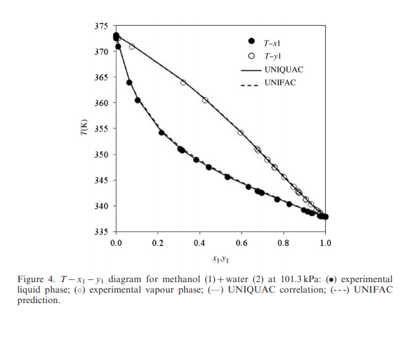
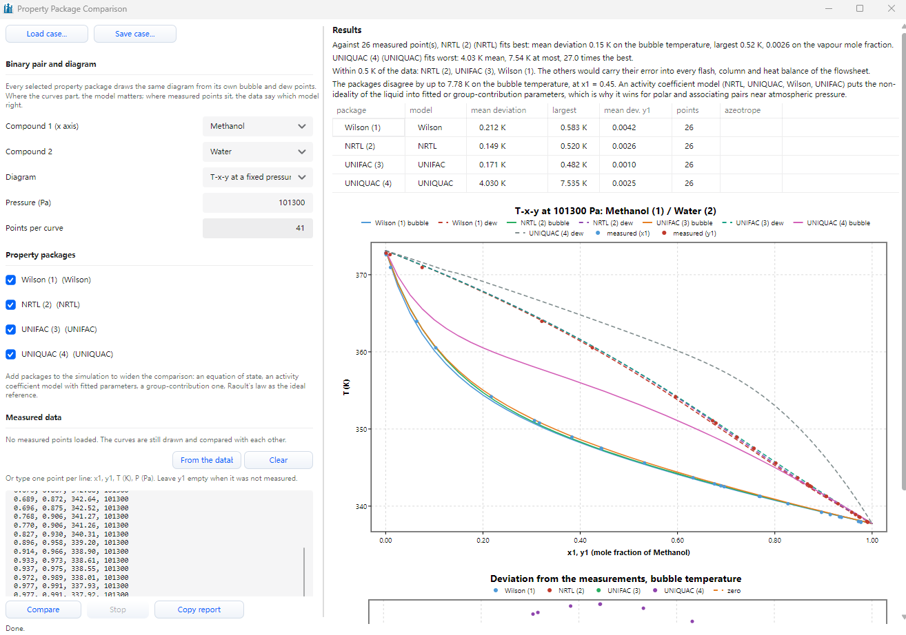
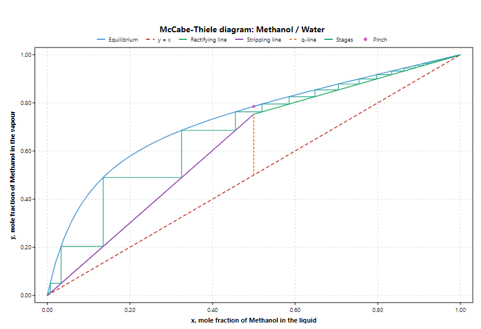
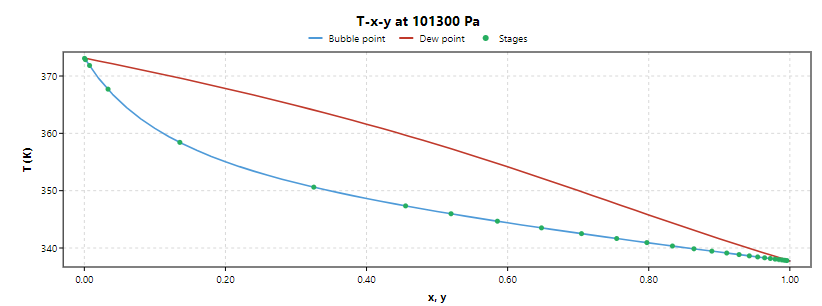
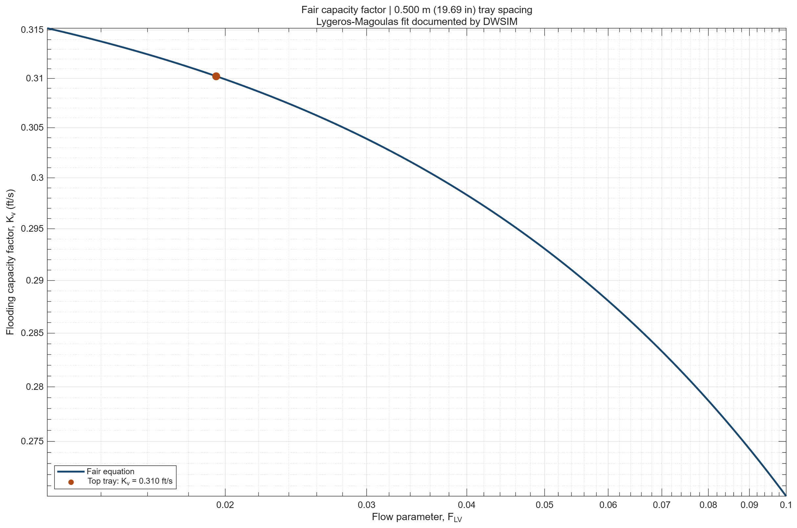
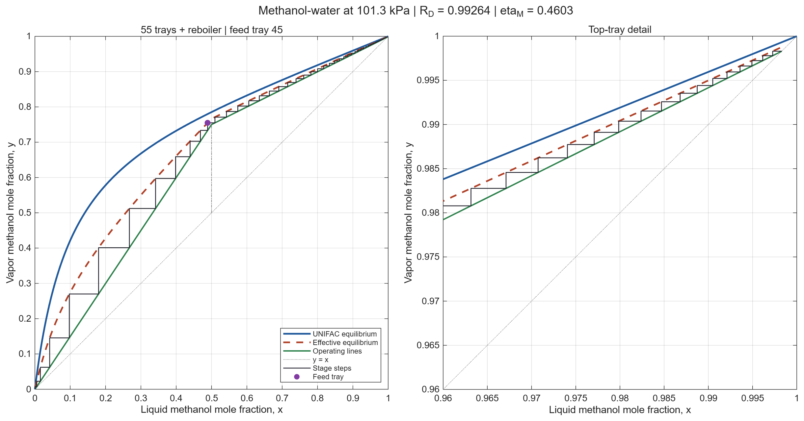

# e-메탄올 정제용 메탄올–물 증류탑 설계 로드맵

조메탄올을 약 1 atm의 연속 증류탑에 넣어 탑정에서 메탄올을 회수하고, 탑저로 물을 보낸다. **목표 조성을 달성하려면 이론단수와 환류비가 얼마나 필요한가? McCabe–Thiele의 예비 설계를 DWSIM에 넣으면 제품 조성과 열부하가 어떻게 달라지는가?** 이 두 질문을 중심으로 진행한다.

**표기** · 성분 A는 메탄올, 성분 B는 물이다. 평형 조성 $x_e,y_e$와 공급·제품 조성 $x_F,x_D,x_B$는 모두 **메탄올 몰분율**로 적는다. 물질수지의 $F,D,B$는 각각 공급·탑정·탑저의 몰유량이다. $R_D=L/D$는 환류비, $R_{Dm}$은 최소 환류비, $q$는 공급의 열적 상태를 나타낸다. $q_r$과 $q_c$는 각각 재비기에 공급하는 열과 응축기에서 제거하는 열의 크기로 표시한다.

---

# 0단계 · e-메탄올을 왜 정제하는지

메탄올은 포름알데히드나 초산을 만드는 원료로 쓰이고, 연료로도 사용할 수 있다. e-메탄올은 재생전력으로 생산한 수소와 포집한 이산화탄소로 합성하는 메탄올이다. 이때 반응식에서 보듯 물이 같이 생긴다. [IRENA·Methanol Institute, Renewable Methanol](https://www.irena.org/Publications/2021/Jan/Innovation-Outlook-Renewable-Methanol)

$$
\mathrm{CO_2+3H_2\rightarrow CH_3OH+H_2O}
$$

이번 설계에서는 반응 후의 액상 제품을 **메탄올–물 이성분 공급물**로 단순화했다. 메탄올과 물이 1:1 몰비이면 물은 약 **36 wt%**라, 탑정 제품의 물 함량을 **IMPCA 참고 규격의 0.100 wt% 이하**로 낮추려면 정제가 필요하다. 그래서 조메탄올을 증류탑에 넣어 탑정에서 메탄올을 회수하고 탑저로 물을 보낸다. [IMPCA 메탄올 참고 규격, p. 2](https://impca.eu/wp-content/uploads/2024/10/IMPCA-Ref-Spec-10-October-2024.pdf#page=2)

강의 예제와 같은 메탄올–물 계를 쓰되, 이번에는 **제품 사양 설정 → 실측 VLE로 물성 모델 선정 → DWSIM 검증 → 체판과 실제 단수 설계**까지 한 기준안으로 연결했다.

---

# 1단계 · 순수 물성과 1 atm 실측 VLE 확보
## 1단계 · 메탄올–물 순수성분 물성

| 물성 | 메탄올 (성분 A) | 물 (성분 B) |
|---|---:|---:|
| CAS 번호 | 67-56-1 | 7732-18-5 |
| 몰질량 $M_i$ (g/mol) | 32.0419 | 18.0153 |
| 정상 끓는점 $T_{b,i}$ (K) | 337.8 ± 0.3 | 373.17 ± 0.04 |
| 몰 기화잠열 $\lambda_i$ (kJ/mol) | 35.21 (337.7 K) | 약 40.65 (373.15 K) |

물의 몰 기화잠열은 100 °C 포화 상태의 기화잠열 $2256.4\ \mathrm{kJ/kg}$에 몰질량 $0.0180153\ \mathrm{kg/mol}$을 곱해 환산했다. 두 잠열은 각 순수성분의 표기 온도에서의 값이다. [NIST 메탄올 물성](https://webbook.nist.gov/cgi/cbook.cgi?ID=C67561&Mask=4), [NIST 물 물성](https://webbook.nist.gov/cgi/cbook.cgi?ID=C7732185&Mask=4), [NIST 포화 수증기표, Table 1](https://tsapps.nist.gov/publication/get_pdf.cfm?pub_id=906704)

### 순수성분 증기압 · Antoine 식

$$
\log_{10}\!\left(\frac{P'_i}{\mathrm{bar}}\right)
= a_i-\frac{b_i}{T/\mathrm{K}+c_i}
$$

| 성분 | NIST 유효 온도 범위 (K) | $a_i$ | $b_i$ | $c_i$ |
|---|---:|---:|---:|---:|
| 메탄올 (A) | 288.10–356.83 | 5.20409 | 1581.341 | −33.50 |
| 메탄올 (A) | 353.50–512.63 | 5.15853 | 1569.613 | −34.846 |
| 물 (B) | 334–363 | 5.07680 | 1659.793 | −45.854 |
| 물 (B) | 344–373 | 5.08354 | 1663.125 | −45.622 |

온도는 K로 넣는다. 두 성분 모두 계산 결과가 bar로 나오므로, kPa로 쓰려면 100을 곱한다. 이번 비등 구간에서 직접 계산할 때는 두 성분 모두 355 K 미만에서 각 성분의 첫 번째 계수, 355 K 이상에서 두 번째 계수를 쓰면 된다. 물의 두 번째 식은 373 K까지만 적용하고, 1 atm의 순수 물 끝점은 위 표의 정상 끓는점으로 표시한다. [NIST 메탄올 Antoine 계수](https://webbook.nist.gov/cgi/cbook.cgi?ID=C67561&Mask=4&Type=ANTOINE), [NIST 물 Antoine 계수](https://webbook.nist.gov/cgi/cbook.cgi?ID=C7732185&Mask=4&Type=ANTOINE)
### 메탄올–물 기액평형(VLE) 실측 데이터

Álvarez 등(2011)의 Table 2에서 Methanol (1) + Water (2) 구간을 옮겼다. 실험 압력은 101.3 kPa이다. 원문의 \(x_1\)과 \(y_1\)은 각각 액상과 기상의 메탄올 몰분율이며, 여기서는 \(x_e\)와 \(y_e\)로 표기한다.

| $x_e$ | $y_e$ | $T$ (°C) |
|---:|---:|---:|
| 0.0001 | 0.001 | 99.65 |
| 0.001 | 0.009 | 99.46 |
| 0.010 | 0.075 | 97.79 |
| 0.064 | 0.321 | 90.81 |
| 0.103 | 0.425 | 87.38 |
| 0.217 | 0.596 | 81.04 |
| 0.306 | 0.672 | 77.93 |
| 0.316 | 0.679 | 77.62 |
| 0.383 | 0.722 | 75.80 |
| 0.443 | 0.757 | 74.35 |
| 0.444 | 0.757 | 74.32 |
| 0.532 | 0.802 | 72.44 |
| 0.632 | 0.847 | 70.52 |
| 0.676 | 0.867 | 69.73 |
| 0.689 | 0.872 | 69.49 |
| 0.696 | 0.875 | 69.37 |
| 0.768 | 0.906 | 68.12 |
| 0.770 | 0.906 | 68.11 |
| 0.827 | 0.930 | 67.16 |
| 0.896 | 0.958 | 66.05 |
| 0.914 | 0.966 | 65.75 |
| 0.933 | 0.973 | 65.46 |
| 0.937 | 0.975 | 65.40 |
| 0.972 | 0.989 | 64.86 |
| 0.977 | 0.991 | 64.78 |
| 0.977 | 0.991 | 64.77 |

모든 실측점에서 $y_e>x_e$이므로, 평형에서 메탄올의 몰분율은 액상보다 기상에서 더 높다. 공급 조성 $x_F=0.50$ 근처에서도 같은 경향이 나타난다.

[출판사 페이지 · DOI](https://www.tandfonline.com/doi/pdf/10.1080/00319100903012403?casa_token=Q1QBQpXpIX8AAAAA:JdzesQyhwraLLvEZ0wsn0dOSCJnfL7H5ssKUr5gu2f3w_QUMSeDyDYxQHVdMuq4DG_peJluIIOLJkFE#page=1.00&gsr=0)

# 2단계 · DWSIM 물성 모델 비교

DWSIM의 **Property Package Comparison**에서 메탄올(1)–물(2) 계의 $T$–$x$–$y$ 선도를 계산했다. 압력은 **101.3 kPa**로 고정했고, Álvarez 등(2011)의 실측점 **26개**를 기준으로 Wilson, NRTL, UNIFAC, UNIQUAC을 비교했다. $x_e$와 $y_e$는 각각 액상과 기상의 메탄올 몰분율이다.

| 모델 | 기포점 온도 평균 절대오차 (K) | 기포점 온도 최대 절대오차 (K) | $y_e$ 평균 절대오차 | 비교 실측점 수 | 계산된 공비점 |
|---|---:|---:|---:|---:|---|
| Wilson | 0.212 | 0.583 | 0.0042 | 26 | 없음 |
| NRTL | **0.149** | 0.520 | 0.0026 | 26 | 없음 |
| UNIFAC | 0.171 | **0.482** | **0.0010** | 26 | 없음 |
| UNIQUAC | 4.030 | 7.535 | 0.0025 | 26 | 없음 |

기포점 온도 평균 오차는 **NRTL**이 가장 작았고, 기포점 온도 최대 오차와 기상 조성 $y_e$의 평균 오차는 **UNIFAC**이 가장 작았다. DWSIM의 기본 순위는 기포점 온도 평균 오차를 기준으로 해서 NRTL이 1위로 표시됐다. 네 모델의 기포점 예측값 사이의 차이는 $x_e=0.45$에서 최대 **7.78 K**였다.

UNIQUAC의 기포점 평균 오차 4.030 K는 이번 DWSIM 설정에서의 결과다. 원인을 확인하려면 메탄올–물 이성분 상호작용 파라미터의 값과 출처를 따로 확인해야 한다.

### 최종 모델 선정

이번 설계에서는 **UNIFAC**을 사용한다. McCabe–Thiele 작도에 직접 쓰는 값이 $x_e$에 대응하는 평형 기상 조성 $y_e$이므로, 모델 선정에서 $y_e$ 오차를 우선했다. UNIFAC의 $y_e$ 평균 절대오차는 **0.0010(0.10%p)**였고, 기포점 온도 평균 절대오차도 **0.171 K**로 NRTL보다 **0.022 K** 높았다. 이후 McCabe–Thiele 작도와 DWSIM 증류탑 계산에 같은 UNIFAC 모델을 사용한다.

[실측 데이터 출처 · Álvarez 등(2011), Table 2](https://doi.org/10.1080/00319100903012403)

---

# 3단계 · 공급 조건과 제품 사양 정하기

우선 공급물은 메탄올과 물이 반반 들어 있는 포화액체로 잡았다. 실측 VLE 압력과 맞춰서 3–6단계의 예비 계산에서는 탑 전체를 101.3 kPa(abs)로 두었다. 실제 트레이를 반영했을 때의 압력강하는 7단계에서 따로 추정한다.

| 항목 | 설계 조건 |
|---|---|
| 물성 모델 | UNIFAC |
| 예비 계산 압력 | 탑 전체 101.3 kPa(abs), 압력강하 0 |
| 공급 유량 | 20,000 kg/h |
| 공급 메탄올 몰분율 $x_F$ | 0.50 |
| 공급 상태 | 포화액체, $q=1$ |
| 탑정 메탄올 몰분율 $x_D$ | 0.9983 이상 |
| 탑저 메탄올 몰분율 $x_B$ | 0.001 이하 |

탑정은 원래 메탄올 99.5 mol%로 잡았는데, 질량 기준으로 바꿔보면 물이 약 0.282 wt%라 IMPCA의 물 함량 기준인 0.100 wt%를 넘었다. 그래서 $x_D$를 **0.9983**으로 올렸다. 이렇게 하면 탑정 물 함량이 약 **0.0957 wt%**가 된다. 탑저는 메탄올 손실을 줄이기 위한 팀 목표로 $x_B=0.001$을 유지했다. 이 값은 물 99.9 mol%, 메탄올 약 0.178 wt%에 해당한다. [IMPCA 메탄올 참고 규격, p. 2](https://impca.eu/wp-content/uploads/2024/10/IMPCA-Ref-Spec-10-October-2024.pdf#page=2)

그다음 1단계에서 정리한 몰질량으로 공급 유량을 몰 기준으로 바꾸고, 두 제품이 목표 조성에 딱 도달한다고 놓고 물질수지를 계산했다.

$$
F=D+B,\qquad Fx_F=Dx_D+Bx_B
$$

| 흐름 | 몰유량 (kmol/h) |
|---|---:|
| 공급 $F$ | 799.09 |
| 탑정 $D$ | 399.82 |
| 탑저 $B$ | 399.26 |

---

# 4단계 · McCabe–Thiele 선도 그리기

DWSIM의 **McCabe–Thiele Diagram**에서 UNIFAC을 선택하고, 위에서 정한 압력과 조성을 넣었다. 환류비는 예비 설계값으로 **최소 환류비의 1.3배**를 잡고, 단효율은 1로 두고 작도했다.

| 항목 | 작도 결과 |
|---|---:|
| 최소 환류비 $R_{Dm}$ | 0.7459 |
| 예비 운전 환류비 $R_D$ | 0.9697 |
| 전환류에서의 최소 이론단수 $N_{\min}$ | 10단 |
| 예비 운전에서의 이론단수 $N$ | 27단 |
| 공급단 위치 | 탑정에서 21번째 트레이 |

### 평형선과 조작선을 어떻게 그렸는지

**평형선**은 101.3 kPa에서 액상 메탄올 몰분율 $x_e$를 0부터 1까지 바꿔가며 그렸다. DWSIM이 각 조성에서 UNIFAC으로 기포점 온도와 평형 기상 조성 $y_e$를 계산하고, 그 $(x_e,y_e)$를 연결한 게 그림의 파란 선이다. 예를 들어 $x_e=0.5000$에서 계산한 $y_e$는 **0.7854**였다. 이 압력에서 액체에 메탄올이 50 mol% 들어 있으면, 그 액체와 평형인 기체에는 약 78.54 mol%가 들어 있다는 뜻이다.

**정류부 조작선**은 일정 몰유량(CMO)을 가정하고, 공급단 위쪽의 물질수지로 그렸다. 정류부의 액체와 기체 몰유량을 각각 $L$, $V$라고 하면 전응축기에서 $V=L+D$이고, 메탄올 수지는 $Vy=Lx+Dx_D$이다. 여기에 $R_D=L/D$를 넣으면 아래 직선이 나온다.

$$
y=\frac{R_D}{R_D+1}x+\frac{x_D}{R_D+1}
=\frac{0.9697}{1.9697}x+\frac{0.9983}{1.9697}
\approx0.4923x+0.5068
$$

이 직선은 대각선 위의 탑정점 $(x_D,x_D)=(0.9983,\ 0.9983)$을 지난다. 공급물은 포화액체라 $q=1$이고, **$q$-line**은 $x=x_F=0.50$인 수직선이다. 정류부 조작선에 $x=0.50$을 넣으면 교점이 **$(0.5000,\ 0.7530)$**으로 나온다. 이 교점과 탑저점 $(x_B,x_B)=(0.0010,\ 0.0010)$을 이으면 **탈거부 조작선**이 된다.

**최소 환류와 작도에 쓴 환류비**를 그림에서 보면, 이 경우 최소 환류에서는 두 조작선의 교점이 평형선 위의 **$(0.5000,\ 0.7854)$**에 닿는다. 이 점이 핀치점이고, 탑정점과 핀치점을 이은 직선의 기울기를 $m_{\min}$이라고 하면, $R_{Dm}=m_{\min}/(1-m_{\min})=(x_D-y_{\mathrm{pinch}})/(y_{\mathrm{pinch}}-x_F)=0.7459$로 구했다. 작도에 사용한 $R_D=0.9697$에서는 두 조작선이 평형선보다 아래인 $(0.5000,\ 0.7530)$에서 만난다.

**단수는 계단을 세어서** 구했다. 탑정점에서 가로로 평형선까지, 세로로 조작선까지 이동하는 걸 반복한다. 가로 이동으로 한 단의 평형 액상 조성을 구하고, 세로 이동으로 바로 아래 단에서 올라오는 기상 조성을 구한다. 계단이 $q$-line을 지날 때 탈거부 조작선으로 바꾼다. 이렇게 세면 **이상 트레이 26개와 부분재비기 1단을 합쳐 27이론단**이 나오고, 공급 위치는 위에서 21번째 트레이다.

[작도 참고 · DWSIM McCabe–Thiele 안내](https://dwsim.org/tutorials/en/fundamentals/07-the-learning-tools.html#mccabe-thiele-diagram)

---

# 5단계 · DWSIM에서 증류탑 검증하고 환류비 찾기

McCabe–Thiele에서 나온 단수와 공급 위치를 **Distillation Column**에 옮겼다. DWSIM에서는 전응축기를 1번 위치로 세기 때문에 **총 28개 위치**를 입력했고, 공급물은 **Stage 22**에 연결했다. 압력은 **101.3 kPa**, 물성 모델은 **UNIFAC**으로 유지했다. 공급물은 포화액체로 설정했고 응축기는 **Total**로 뒀다. 재비기 쪽 **Product Molar Flow Rate**는 $B=110.906\ \mathrm{mol/s}$ (약 $399.26\ \mathrm{kmol/h}$)로 고정했다.

### 두 제품 사양을 만족하는 환류비

우선 작도에서 나온 $R_D=0.9697$을 그대로 넣어봤다. 탑정 메탄올 몰분율이 0.99791366으로 나와 목표인 0.9983에 조금 못 미쳤다. 이후 $R_D=1.00$에서 두 사양을 만족하는 걸 확인했다. 단수, 공급 위치, 탑저 유량을 그대로 두고 환류비만 바꿔서 **$x_D\geq0.9983$과 $x_B\leq0.001$을 동시에 만족하는 경계**를 찾았다.

| 환류비 $R_D$ | 탑정 메탄올 몰분율 $x_D$ | 탑저 메탄올 몰분율 $x_B$ | 판정 |
|---:|---:|---:|---|
| 0.96970 | 0.99791366 | — | 탑정 미달 |
| 1.00000 | 0.9984033091 | 0.0008923394 | 충족 |
| 0.99000 | 0.9982608317 | 0.0010350181 | 탑정·탑저 미달 |
| 0.99250 | 0.9982980602 | 0.0009977371 | 탑정 미달 |
| 0.99263 | 0.9982999658 | 0.0009958287 | 탑정 미달 |
| **0.99264** | **0.9983001123** | **0.0009956820** | **충족** |

$R_D=0.99000$과 $1.00000$ 사이에서 중간값을 넣어보고, 충족하면 위쪽 끝을 낮추고 미달이면 아래쪽 끝을 높이는 식으로 범위를 좁혔다. 계산상 경계는 **$R_D\approx0.992632$**였다. 탑저 사양은 그보다 낮은 환류비에서도 먼저 충족했고, 최종 경계는 **탑정 조성**이 결정했다. 따라서 소수점 다섯 자리로 입력할 때는 **$R_D=0.99264$**를 28개 위치 기준값으로 쓴다. 이때 탑정 물 함량은 약 **0.0957 wt%**다. 탑정 조성 $x_D=0.9983001123$은 사양 경계에 가까우므로, 실제 운전점을 정할 때는 공급 변동 등을 고려해 환류비나 트레이 수에 여유를 둔다.

4단계의 $R_{Dm}=0.7459$는 McCabe–Thiele 선도에서 얻은 최소 환류비다. 여기서 구한 값은 **28개 위치로 고정한 DWSIM 증류탑**에서 두 제품 사양을 만족시키는 환류비다.

### CMO 가정과 DWSIM 단별 유량 비교

McCabe–Thiele에서는 정류부와 탈거부 각각에서 $L,V$가 일정하다고 두었다. 같은 UNIFAC, 101.3 kPa의 DWSIM 기준안에서 단별 결과를 확인하니 아래처럼 구간 안에서도 유량이 달랐다.

| 구간 | 비교한 몰유량 | 시작 → 끝 (mol/s) | 감소율 |
|---|---|---:|---:|
| 정류부 | 액체 $L_n$, Stage 2 → 21 | 110.189 → 100.813 | 8.5% |
| 탈거부 | 기체 $V_n$, Stage 22 → 27 | 211.876 → 194.805 | 8.1% |

메탄올과 물의 정상 비점 기준 몰 기화잠열이 각각 **35.21, 약 40.65 kJ/mol**이고, 탑 안에서 조성과 온도도 달라진다. DWSIM에서는 단별 엔탈피 수지를 풀기 때문에 그 차이가 내부 유량에도 반영된다. 실제로 작도에 쓴 $R_D=0.9697$을 같은 단수와 공급 위치의 DWSIM 모델에 넣었을 때 탑정 사양이 미달했고, 엄밀 계산에서는 $R_D=0.99264$에서 두 사양을 충족했다. 구간 내 몰유량 변화는 두 계산의 차이를 설명하는 요인 중 하나다. [단별 원자료](#dwsim-단별-결과--온도-압력-기액-몰유량)

### 열부하와 전체 열수지 확인

| 항목 | $R_D=0.99264$에서의 결과 |
|---|---:|
| 응축기에서 제거한 열 $q_c$ | 7,843.345 kW |
| 재비기에 공급한 열 $q_r$ | 7,978.962 kW |

전체 열수지는 아래 식으로 확인했다. $H_F$, $H_D$, $H_B$는 각각 공급, 탑정, 탑저의 몰 엔탈피다.

$$
FH_F+q_r=DH_D+BH_B+q_c
$$

DWSIM 스트림에서 탑정과 탑저의 엔탈피 유량을 더하고 공급 엔탈피 유량을 빼니 **135.62 kW**가 나왔다. $q_r-q_c$와 소수점 둘째 자리까지 일치했다. 기존 $R_D=1.00$에서의 재비기 열부하 8,007.91 kW와 비교하면 **28.95 kW** 줄었다.

---

# 6단계 · 단수에 따른 환류비와 열부하 비교

5단계에서는 28개 위치에서 두 제품 사양을 만족하는 환류비를 찾았다. 이번에는 공급단 위쪽 트레이를 두 개 줄이거나 늘렸을 때 필요한 환류비와 열부하가 얼마나 달라지는지 확인해봤다.

압력은 **101.3 kPa**, 물성 모델은 **UNIFAC**, 탑저 유량은 **110.906 mol/s**로 고정했다. 공급 조건은 5단계와 같게 뒀다. **26·28·30개 위치에 Feed를 각각 20·22·24번**에 연결해서 공급단 아래 단 수는 같게 맞췄다. DWSIM 위치 수에는 전응축기와 부분재비기가 들어간다. 전응축기를 빼고 이론단을 세면 각각 **25·27·29단**이고, 이 중 부분재비기를 빼면 탑 내부의 이론 트레이는 **24·26·28개**다. 계산에서는 단효율을 모두 1로 뒀다.

### 두 사양을 만족하는 환류비 비교

5단계와 같이 $x_D\geq0.9983$, $x_B\leq0.001$을 기준으로 잡았다. 26개 위치는 $R_D=1.00$과 $1.05$ 사이, 30개 위치는 $0.95$와 $0.97$ 사이에서 시작했다. 중간값을 넣어 둘 다 충족하면 위쪽 끝을 낮추고, 하나라도 미달하면 아래쪽 끝을 높여서 환류비 구간을 $10^{-6}$ 이내로 좁혔다.

| DWSIM 위치 수 | 공급 위치 | 환류비 경계 근삿값 | 소수점 다섯 자리에서 미달 | 소수점 다섯 자리에서 충족 |
|---:|---:|---:|---:|---:|
| 26 | 20 | 1.039666 | 1.03966 | **1.03967** |
| 28 | 22 | 0.992632 | 0.99263 | **0.99264** |
| 30 | 24 | 0.957741 | 0.95774 | **0.95775** |

세 경우 모두 탑저 사양이 먼저 충족됐고, 환류비 경계는 **탑정 메탄올 몰분율**이 결정했다. 소수점 다섯 자리에서 사양을 충족한 환류비를 다시 넣고 조성과 열부하를 확인했다.

| DWSIM 위치 수 | 환류비 $R_D$ | 탑정 $x_D$ | 탑저 $x_B$ | $q_c$ (kW) | $q_r$ (kW) |
|---:|---:|---:|---:|---:|---:|
| 26 | 1.03967 | 0.9983000532 | 0.0009957412 | 8,028.46 | 8,164.08 |
| **28** | **0.99264** | 0.9983001123 | 0.0009956820 | 7,843.35 | 7,978.96 |
| 30 | 0.95775 | 0.9983001601 | 0.0009956342 | 7,706.01 | 7,841.63 |

### 단수와 재비기 열부하 비교

- **26 → 28개 위치**에서 재비기 열부하가 **185.12 kW (2.27%)** 줄었다.
- **28 → 30개 위치**에서 재비기 열부하가 **137.33 kW (1.72%)** 더 줄었다.

정류부에 트레이를 추가할수록 같은 조성 사양을 더 낮은 환류비와 열부하로 맞출 수 있었다. 두 번째로 트레이 두 개를 추가했을 때는 열부하 절감 폭이 더 작았다. 이후 실제 단수를 추정할 때는 McCabe–Thiele 작도에서 시작한 **28개 위치, 공급 위치 22번, $R_D=0.99264$**를 기준으로 둔다. 30개 위치는 이론 트레이 두 개를 추가해 재비기 열부하를 **137.33 kW** 낮춘 대안으로 같이 제시한다.

---

# 7단계 · 예제 21.6 방식으로 체판탑 설계

강의자료 7번 p.27–31의 **예제 21.6**처럼 탑정 트레이의 정격 조건에서 탑경, 단당 압력강하, 다운커머 froth height를 순서대로 구했다. DWSIM 기준안은 **UNIFAC, 28개 위치, 공급 위치 22번, $R_D=0.99264$**이다. 이 조건에서 다시 계산한 탑정 제품의 몰유량은 **111.062734 mol/s**, 질량유량 $w_D$는 **12,801.63 kg/h**다.

| 입력값 | 적용값 |
|---|---:|
| 트레이 간격 $l_t$ | 0.500 m = 19.685 in = 500 mm |
| 탑정 트레이 기체 밀도 $\rho_V$ (Stage 2) | 1.15483 kg/m³ |
| 탑정 트레이 액체 밀도 $\rho_L$ (Stage 2) | 754.931 kg/m³ |
| 액체 표면장력 $\sigma$ (Stage 2) | 0.0190639 N/m = 19.0639 dyn/cm |
| 기포 면적 $A_b$ / 탑 전체 단면적 $A_c$ | 0.70 |
| 체판 두께 / 구멍 지름 / 삼각 배열 피치 | 1/8 in / 1/4 in / 3/4 in |
| 위어 높이 $h_w$ | 2 in = 50.8 mm |

### (a) 최대 기체 속도와 탑경

탑에서 올라온 증기는 전응축기에서 모두 응축된 뒤 환류와 탑정 제품으로 나뉜다. 두 액체의 조성이 같으므로 이 수지에는 질량유량비로도 $R_D$를 적용할 수 있다.

$$
w_L=R_Dw_D=3.52984\ \mathrm{kg/s},
\qquad
w_V=(1+R_D)w_D=7.08584\ \mathrm{kg/s}
$$

$$
F_{LV}=\frac{w_L}{w_V}\sqrt{\frac{\rho_V}{\rho_L}}
=\frac{0.99264}{1.99264}\sqrt{\frac{1.15483}{754.931}}
=0.0194836
$$

$K_v$는 DWSIM 문서에 공개된 Lygeros–Magoulas 식으로 구했다. 트레이 간격은 **19.685 in**이며, 식에 넣을 때는 mm 단위인 **500 mm**를 사용했다. [DWSIM Fair 상관식](https://dwsim.org/help/main/24-unit-operations.html#entrainment-flooding)

$$
K_1=0.0105+8.127\times10^{-4}l_t^{0.755}
\exp(-1.463F_{LV}^{0.842})
=0.094560\ \mathrm{m/s}
$$

강의자료의 속도 단위로 환산하면 $K_v=K_1/0.3048=0.310236\ \mathrm{ft/s}$다. 이 값을 p.8의 식에 넣어 최대 기체 속도를 구했다.

$$
u_c=K_v\sqrt{\frac{\rho_L-\rho_V}{\rho_V}}
\left(\frac{\sigma}{20}\right)^{0.2}
=7.8504\ \mathrm{ft/s}=2.3928\ \mathrm{m/s}
$$

예제와 같이 $u_c$를 사용해 기포 면적을 구하고, 기포 면적이 전체 단면적의 70%라고 놓았다.

$$
Q_V=\frac{w_V}{\rho_V}=6.1358\ \mathrm{m^3/s},
\qquad A_b=\frac{Q_V}{u_c}=2.5643\ \mathrm{m^2}
$$

$$
A_c=\frac{A_b}{0.70}=3.6633\ \mathrm{m^2},
\qquad D_c=\sqrt{\frac{4A_c}{\pi}}=\mathbf{2.160\ \mathrm{m}}
$$

DWSIM의 자체 수력학 평가는 순 기체 통과 면적을 기준으로 한다. 여기서는 공개식에서 구한 계수를 예제의 기포 면적 계산에 적용해 **예비 탑경**을 구했다. [DWSIM 면적 기준](https://dwsim.org/help/main/24-unit-operations.html#areas)

### (b) 탑정 트레이의 압력강하

구멍 지름 $d_h=1/4\ \mathrm{in}$, 삼각 배열 피치 $p_h=3/4\ \mathrm{in}$을 사용했다. 예제와 같이 체판 두께와 구멍 지름의 비는 0.50이므로 Fig. 21.25에서 읽은 $C_0=0.73$을 적용했다.

$$
\frac{A_h}{A_b}=\frac{\pi}{2\sqrt{3}}\left(\frac{d_h}{p_h}\right)^2
=0.10077,\qquad
A_h=0.2584\ \mathrm{m^2},\qquad u_0=\frac{Q_V}{A_h}=23.75\ \mathrm{m/s}
$$

$$
h_d=51.0\left(\frac{u_0}{C_0}\right)^2\frac{\rho_V}{\rho_L}
=82.55\ \mathrm{mm}
$$

예제와 같이 양쪽에 각각 전체 단면적의 15%를 잡아 위어 길이 $L_w$를 계산했다. Francis 식에서 $q_L$은 $\mathrm{m^3/min}$, $L_w$는 m로 넣는다.

$$
L_w=1.62\frac{D_c}{2}=1.7493\ \mathrm{m},
\qquad q_L=60\frac{w_L}{\rho_L}=0.28054\ \mathrm{m^3/min}
$$

$$
h_{ow}=43.4\left(\frac{q_L}{L_w}\right)^{2/3}=12.81\ \mathrm{mm},
\qquad h_l=0.60(h_w+h_{ow})=38.17\ \mathrm{mm}
$$

$$
h_t=h_d+h_l=120.72\ \mathrm{mm\ of\ liquid},
\qquad \Delta P_{\mathrm{tray}}=\rho_L g\frac{h_t}{1000}
=894.0\ \mathrm{Pa}=\mathbf{0.894\ \mathrm{kPa}}
$$

### (c) 다운커머 froth height 확인

예제의 액체 마찰손실 수두 $h_{f,L}=10\ \mathrm{mm}$, 다운커머 액체 체적분율 $\phi_d=0.50$을 적용했다.

$$
Z_c=h_l+h_t+h_{f,L}=168.88\ \mathrm{mm},
\qquad Z=\frac{Z_c}{\phi_d}=\mathbf{337.76\ \mathrm{mm}}
$$

**탑정 트레이에서 $Z=337.76\ \mathrm{mm}<500\ \mathrm{mm}$**이므로, 예제 21.6의 다운커머 flooding 판정 기준을 충족했다. 간격과 froth height의 차이는 **162.24 mm**다.

### (d) 기체 속도 운전 여유를 반영한 예비 설계

예제 방식의 한계 탑경은 정격 기체 체적유량 $Q_V$를 최대 기체 속도 $u_c$로 나눠 구했다. 설계안에서는 정격 기체 속도를 **$u_{\mathrm{op}}=0.80u_c$**로 잡았다. $Q_V$와 기포 면적 비율 $A_b/A_c=0.70$을 고정하면 필요한 기포 면적은 한계 기준의 $1/0.80=1.25$배가 된다.

$$
D_{c,\mathrm{design}}=\frac{D_{c,\mathrm{limit}}}{\sqrt{0.80}}
=\frac{2.15968}{\sqrt{0.80}}=\mathbf{2.415\ \mathrm{m}}
$$

| 탑정 트레이 기준 | 최대 기체 속도 기준 | 80% 운전 기준 |
|---|---:|---:|
| 정격 기체 속도 $u_{\mathrm{op}}$ (m/s) | 2.393 | 1.914 |
| 기포 면적 $A_b$ (m²) | 2.564 | 3.205 |
| 탑경 $D_c$ (m) | 2.160 | 2.415 |
| 단당 압력강하 $\Delta P_{\mathrm{tray}}$ (kPa) | 0.894 | 0.670 |
| 다운커머 froth height $Z$ (mm) | 337.8 | 276.1 |

설계 탑경 **2.415 m**와 같은 트레이 형상을 고정하고, 6단계 DWSIM 기준안의 Stage 2–27 단별 유량과 물성으로 $Z$를 다시 확인했다. 최대값은 **Stage 2에서 약 276.1 mm**였고, 트레이 간격 **500 mm**보다 낮았다. 7단계의 예비 설계 탑경으로는 80% 기준의 **2.415 m**를 사용한다.

### (e) 정압 가정의 한계와 탑저 압력 추정

3–6단계는 탑 전체를 **101.3 kPa**로 둔 예비 계산이었다. 80% 운전 기준에서 구한 **탑정 트레이의 0.670 kPa**를 실제 트레이 전체에 똑같이 적용해 크기만 추정하면, 8단계의 **56–58개 트레이**에서 전체 압력강하는 약 **37.5–38.9 kPa**다. 탑정이 **101.3 kPa(abs)**이면 탑저는 약 **138.8–140.2 kPa(abs)**가 된다.

이 압력 범위에서 탑저 목표 조성 $x_B=0.0010$을 넣고 UNIFAC으로 기포점을 계산하니 **약 109 °C**였다. 정압 가정에서 같은 조성의 기포점은 약 **99.8 °C**였다. 재비기 온도와 상대휘발도는 압력에 따라 달라질 수 있으므로, 실제 단수 검증에는 단별 유량으로 갱신한 압력강하를 반영한다. 여기서 얻은 탑저 압력은 탑정의 단당 값을 곱해 얻은 **검증용 시작값**이다.

[MATLAB 계산 파일](fair_flow_parameter.m)

### 참고 · DWSIM 단별 원자료

### DWSIM 단별 결과 · 온도, 압력, 기·액 몰유량

| DWSIM Stage $n$ | $T_n$ (K) | $P_n$ (Pa) | $L_n$ (mol/s) | $V_n$ (mol/s) |
|---:|---:|---:|---:|---:|
| 1 (전응축기) | 337.773 | 101300 | 110.245 | 0 |
| 2 | 337.811 | 101300 | 110.189 | 221.308 |
| 3 | 337.858 | 101300 | 110.119 | 221.251 |
| 4 | 337.916 | 101300 | 110.033 | 221.181 |
| 5 | 337.986 | 101300 | 109.928 | 221.096 |
| 6 | 338.073 | 101300 | 109.799 | 220.99 |
| 7 | 338.18 | 101300 | 109.641 | 220.861 |
| 8 | 338.312 | 101300 | 109.448 | 220.704 |
| 9 | 338.473 | 101300 | 109.214 | 220.511 |
| 10 | 338.669 | 101300 | 108.931 | 220.277 |
| 11 | 338.909 | 101300 | 108.589 | 219.994 |
| 12 | 339.201 | 101300 | 108.18 | 219.652 |
| 13 | 339.554 | 101300 | 107.692 | 219.242 |
| 14 | 339.979 | 101300 | 107.117 | 218.755 |
| 15 | 340.487 | 101300 | 106.447 | 218.18 |
| 16 | 341.088 | 101300 | 105.678 | 217.51 |
| 17 | 341.792 | 101300 | 104.812 | 216.741 |
| 18 | 342.601 | 101300 | 103.861 | 215.875 |
| 19 | 343.511 | 101300 | 102.849 | 214.924 |
| 20 | 344.504 | 101300 | 101.815 | 213.911 |
| 21 | 345.546 | 101300 | 100.813 | 212.878 |
| 22 (공급단) | 346.583 | 101300 | 321.485 | 211.876 |
| 23 | 347.969 | 101300 | 318.013 | 210.579 |
| 24 | 351.843 | 101300 | 311.073 | 207.107 |
| 25 | 360.134 | 101300 | 305.56 | 200.167 |
| 26 | 368.637 | 101300 | 305.711 | 194.654 |
| 27 | 372.101 | 101300 | 306.473 | 194.805 |
| 28 (부분재비기) | 372.931 | 101300 | 110.906 | 195.567 |

### DWSIM 단별 결과 · 액상 및 기상 조성

성분 $A$는 메탄올, 성분 $B$는 물이다. $x$는 액상 몰분율, $y$는 기상 몰분율이며 DWSIM에 표시된 자릿수 그대로 기록했다.

| DWSIM Stage $n$ | 액상 메탄올 $x_{A,n}$ | 액상 물 $x_{B,n}$ | 기상 메탄올 $y_{A,n}$ | 기상 물 $y_{B,n}$ |
|---:|---:|---:|---:|---:|
| 1 (전응축기) | 0.9983 | 0.00169989 | 0.9983 | 0.00169989 |
| 2 | 0.995797 | 0.0042034 | 0.9983 | 0.00169989 |
| 3 | 0.992714 | 0.00728582 | 0.997053 | 0.0029467 |
| 4 | 0.988922 | 0.0110781 | 0.995519 | 0.00448093 |
| 5 | 0.984261 | 0.0157392 | 0.993633 | 0.00636715 |
| 6 | 0.978539 | 0.0214614 | 0.991317 | 0.00868349 |
| 7 | 0.971524 | 0.0284758 | 0.988476 | 0.0115241 |
| 8 | 0.962942 | 0.0370582 | 0.984998 | 0.0150016 |
| 9 | 0.952465 | 0.047535 | 0.98075 | 0.0192496 |
| 10 | 0.939713 | 0.0602871 | 0.975575 | 0.0244252 |
| 11 | 0.924248 | 0.0757521 | 0.96929 | 0.0307097 |
| 12 | 0.905579 | 0.0944206 | 0.961691 | 0.0383091 |
| 13 | 0.883176 | 0.116824 | 0.952549 | 0.0474506 |
| 14 | 0.856492 | 0.143508 | 0.941625 | 0.058375 |
| 15 | 0.825017 | 0.174983 | 0.928678 | 0.0713217 |
| 16 | 0.788359 | 0.211641 | 0.913497 | 0.0865028 |
| 17 | 0.746366 | 0.253634 | 0.895937 | 0.104063 |
| 18 | 0.699309 | 0.300691 | 0.87598 | 0.12402 |
| 19 | 0.648085 | 0.351915 | 0.853814 | 0.146186 |
| 20 | 0.594404 | 0.405596 | 0.829916 | 0.170084 |
| 21 | 0.540807 | 0.459193 | 0.805124 | 0.194876 |
| 22 (공급단) | 0.490356 | 0.509644 | 0.78062 | 0.21938 |
| 23 | 0.427945 | 0.572055 | 0.748088 | 0.251912 |
| 24 | 0.285018 | 0.714982 | 0.656577 | 0.343423 |
| 25 | 0.10963 | 0.89037 | 0.442385 | 0.557615 |
| 26 | 0.0265693 | 0.973431 | 0.171526 | 0.828474 |
| 27 | 0.00539382 | 0.994606 | 0.0411288 | 0.958871 |
| 28 (부분재비기) | 0.000995682 | 0.999004 | 0.007888 | 0.992112 |

Stage 1의 기상 조성은 DWSIM 표시값이고, 전응축기의 기상 출구 유량은 $V_1=0$이다.

### DWSIM 단별 결과 · 질량유량, 밀도, 표면장력

DWSIM **Properties Profile** 표시값이다. $w_{V,n}$과 $w_{L,n}$은 각각 기체·액체 질량유량이다.

| DWSIM Stage $n$ | $w_{V,n}$ (kg/s) | $\rho_{V,n}$ (kg/m³) | $w_{L,n}$ (kg/s) | $\rho_{L,n}$ (kg/m³) | $\sigma_n$ (N/m) |
|---:|---:|---:|---:|---:|---:|
| 1 (전응축기) | 0 | 1.15496 | 3.52984 | 754.858 | 0.0189504 |
| 2 | 7.08584 | 1.15483 | 3.52415 | 754.931 | 0.0190639 |
| 3 | 7.08016 | 1.15404 | 3.51715 | 755.023 | 0.0192035 |
| 4 | 7.07316 | 1.15307 | 3.50856 | 755.139 | 0.0193753 |
| 5 | 7.06457 | 1.15188 | 3.49801 | 755.285 | 0.0195863 |
| 6 | 7.05402 | 1.15041 | 3.4851 | 755.472 | 0.0198453 |
| 7 | 7.0411 | 1.14861 | 3.4693 | 755.709 | 0.0201626 |
| 8 | 7.02531 | 1.14641 | 3.45004 | 756.015 | 0.0205506 |
| 9 | 7.00605 | 1.14372 | 3.42661 | 756.41 | 0.021024 |
| 10 | 6.98262 | 1.14044 | 3.39824 | 756.924 | 0.0215997 |
| 11 | 6.95425 | 1.13646 | 3.36402 | 757.596 | 0.0222972 |
| 12 | 6.92003 | 1.13166 | 3.323 | 758.48 | 0.0231381 |
| 13 | 6.87901 | 1.12588 | 3.27418 | 759.647 | 0.0241457 |
| 14 | 6.83019 | 1.11898 | 3.21661 | 761.191 | 0.0253435 |
| 15 | 6.77262 | 1.11081 | 3.1495 | 763.235 | 0.0267532 |
| 16 | 6.70551 | 1.10125 | 3.07241 | 765.927 | 0.0283904 |
| 17 | 6.62842 | 1.0902 | 2.9855 | 769.44 | 0.0302594 |
| 18 | 6.5415 | 1.07767 | 2.88984 | 773.95 | 0.0323453 |
| 19 | 6.44585 | 1.06379 | 2.78778 | 779.589 | 0.0346046 |
| 20 | 6.34379 | 1.04887 | 2.68311 | 786.371 | 0.0369585 |
| 21 | 6.23912 | 1.03344 | 2.58091 | 794.102 | 0.0392926 |
| 22 (공급단) | 6.13692 | 1.01826 | 8.00281 | 802.33 | 0.0414728 |
| 23 | 6.00326 | 0.998234 | 7.638 | 813.899 | 0.0441423 |
| 24 | 5.63845 | 0.942792 | 6.84769 | 847.105 | 0.050087 |
| 25 | 4.84813 | 0.819441 | 5.97462 | 903.604 | 0.056623 |
| 26 | 3.97507 | 0.674965 | 5.6214 | 936.875 | 0.0587644 |
| 27 | 3.62185 | 0.608792 | 5.54439 | 945.704 | 0.0590366 |
| 28 (부분재비기) | 3.54484 | 0.592203 | 1.99955 | 947.528 | 0.0590693 |

---

# 8단계 · 트레이 효율로 실제 단수 산정하기

### O’Connell 전체 효율로 실제 트레이 수 추정

대표 액체 점도는 탑정 트레이와 재비기 온도의 평균 $\bar{T}=(337.811+372.931)/2=355.371\ \mathrm{K}$, 압력 **101.3 kPa**, 액상 메탄올 몰분율 $x_A=x_F=0.500$에서 DWSIM으로 계산했다. $\mu_L=0.000315023\ \mathrm{Pa\cdot s}=\mathbf{0.3150\ \mathrm{cP}}$다.

상대휘발도는 탑정 트레이와 부분재비기의 단별 액상·기상 조성으로 구했다. 성분 $A$는 메탄올, 성분 $B$는 물이다.

$$
\alpha=\frac{K_A}{K_B}=\frac{y_A/x_A}{y_B/x_B}
$$

| 위치 | $x_A$ | $y_A$ | 상대휘발도 $\alpha$ |
|---|---:|---:|---:|
| Stage 2 · 탑정 트레이 | 0.995797 | 0.9983 | 2.479 |
| Stage 28 · 부분재비기 | 0.000995682 | 0.007888 | 7.977 |
| 두 값의 기하평균 | — | — | **4.447** |

강의자료 7번 p.15의 O’Connell 식에 대표 점도를 **cP**로 넣어 전체 효율을 계산했다.

$$
\eta_0=0.492(\mu_L\alpha)^{-0.245}
=0.492(0.3150\times4.447)^{-0.245}
=\mathbf{0.4530}
$$

$$
N_{\text{실제 트레이}}
=\left\lceil\frac{26}{0.4530}\right\rceil
=\left\lceil57.40\right\rceil
=\mathbf{58\ \text{개}}
$$

이론 트레이 26개에 전체 효율을 적용해 **실제 트레이 58개**를 첫 추정값으로 얻었다. DWSIM 위치 수로는 전응축기와 부분재비기를 하나씩 더해 **60개 위치**에 해당한다.

### Murphree 유효 평형선과 실제 트레이 수

101.3 kPa에서 DWSIM UNIFAC으로 구한 메탄올–물 기액평형점 **224개**를 MATLAB 파일에 넣었다. 정류부와 탈거부 조작선은 $x_F=0.500$, $q=1$, $x_D=0.9983$, $x_B=0.0010$, $R_D=0.99264$로 그렸다. 이 작도에서는 탑 전체를 **101.3 kPa**로 두었다.

O’Connell 전체 효율을 시작값으로 삼아 $\eta_M=0.453$을 적용했다. $y$가 각 구간의 조작선 값일 때, 유효 평형선은 다음과 같다.

$$
y_e'=y+\eta_M(y_e-y)
$$

탑정의 $(x_D,x_D)$에서 출발해 **유효 평형선까지 가로로, 조작선까지 세로로** 이동하면서 트레이를 하나씩 셌다. 45번째 트레이의 액상 조성은 $x=0.50124$, 46번째는 $x=0.48530$이었다. 여기서 수직 $q$-line을 지나므로 **탑정에서 46번째 트레이**를 공급 위치로 잡았다.

부분재비기에는 원래 평형선 $y_e$를 적용했다. 56번째 트레이에 들어오는 기상 조성 $y=0.00706374$를 원래 평형선으로 환산한 탑저 조성은 **$x_B=0.00089078$**이었다. 목표 $x_B\leq0.0010$을 충족하는 첫 정수 단수는 **실제 트레이 56개 + 부분재비기 1단**이었다.

| Murphree 효율 $\eta_M$ | 실제 트레이 수 | 공급 트레이 (위에서) | 부분재비기 포함 단수 | DWSIM 위치 수 | DWSIM 공급 위치 |
|---:|---:|---:|---:|---:|---:|
| 0.403 | 64 | 51 | 65 | 66 | 52 |
| **0.453** | **56** | **46** | **57** | **58** | **47** |
| 0.503 | 51 | 41 | 52 | 53 | 42 |

O’Connell 전체 효율을 적용해 얻은 **58개**와 유효 평형선에서 센 **56개**를 각각 기록했다. DWSIM 위치를 셀 때는 실제 트레이 수에 전응축기와 부분재비기를 각각 하나씩 더하고, 공급 트레이 번호에는 전응축기 위치 하나를 더한다.

[MATLAB 계산 파일](murphree_mccabe_thiele.m)

트레이 간격 0.500 m에서 실제 트레이 56–58개의 맨 위 트레이부터 맨 아래 트레이까지 높이는 $(N_{\mathrm{tray}}-1)l_t=\mathbf{27.5\text{–}28.5\ \mathrm{m}}$다. 탑 상·하부 공간을 합쳐 2–3 m로 가정하면 예비 탑 높이는 **약 29.5–31.5 m**다. 이 값은 예비 탑경 **2.415 m**와 함께 설계 치수로 제시한다.

### DWSIM에서 제품 사양 확인

시간 관계상 DWSIM에서 제품 사양 확인까지는 못 했습니다. 일단 Murphree 작도에서 나온 단수랑 공급 위치까지 정리해뒀고, 시뮬레이션은 조원한테 이어서 부탁하면 될 것 같습니다.

- **시작 조건** · 총 **58개 위치**, 공급 위치 **47번**, $R_D=0.99264$. **내부 트레이에만** $\eta_M=0.453$을 적용하고 부분재비기는 효율 1의 평형단으로 둔다.
- **압력 분포** · 정압 기준과 비교할 때는 탑정 압력을 **101.3 kPa(abs)**로 고정하고, 56개 트레이의 예비값인 전체 압력강하 **약 37.5 kPa**를 먼저 적용한다. 탑저는 **약 138.8 kPa(abs)**이다. 필요하면 수렴 후의 단별 유량으로 압력강하를 다시 계산한다.
- **확인할 값** · 탑정 $x_D\geq0.9983$, 탑저 $x_B\leq0.0010$을 확인한다. 정압과 압력강하 적용 결과의 $x_D,x_B,q_c,q_r$ 및 재비기 온도를 비교한다.

---

# 9단계 · 논문 참고해서 증류탑 비용 비교하기

일단 비용 계산은 논문부터 읽어볼 예정입니다. Wang 등(2019)의 **Appendix A**를 보면 증류탑·응축기·재비기의 설비비를 구하고, 연간 운전비와 합쳐서 TAC를 계산하는 식이 나와 있습니다. 그 계산 틀을 우리 메탄올–물 증류탑 한 기에 적용해보면 될 것 같습니다. [Wang 등(2019), Appendix A](https://www.mdpi.com/2227-9717/7/6/323)

1. **비용에 쓸 기준부터 정한다.** 연간 운전시간, 스팀과 냉각수 단가, 화폐 단위와 기준연도를 표로 정리한다. 설비비를 연간화할 때 쓰는 계수도 같이 정한다.
2. **운전비부터 비교한다.** 6단계에서 같은 제품 사양을 맞춘 **26·28·30개 위치**의 $R_D$, $q_c$, $q_r$를 가져온다. $q_r$로 스팀 비용, $q_c$로 냉각수 비용을 계산해 연간 운전비를 비교한다. 열부하와 유틸리티 단가의 단위가 다르면 먼저 환산한다.
3. **설비비까지 합쳐서 TAC를 비교한다.** 각 후보의 실제 트레이 수와 트레이 간격으로 탑 높이를 추정하고, 해당 후보의 탑경과 응축기·재비기 전열 면적으로 설비비를 구한다. 연간화한 설비비와 연간 운전비를 더해서 비교한 후보 중 TAC가 가장 낮은 조건을 찾는다.

$$
\mathrm{TAC}=C_{\mathrm{capital,annual}}+C_{\mathrm{operating,annual}}
$$
